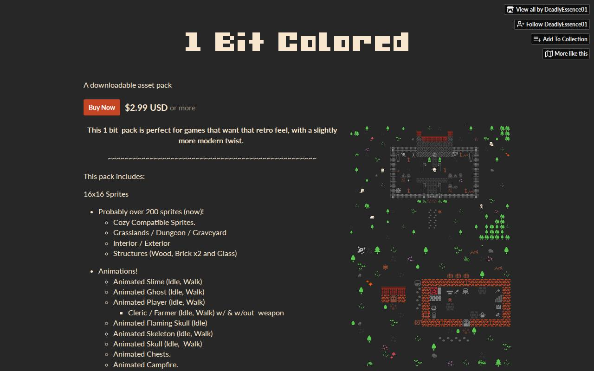

# 1 Bit Colored Pack by DeadlyEssence01

[https://deadlyessence.itch.io/1-bit-colored-pack](https://deadlyessence.itch.io/1-bit-colored-pack)

## Summary

The "1 Bit Colored Pack" is a retro-style pixel art asset collection created by DeadlyEssence01 and hosted on itch.io. Designed for game development, the pack provides versatile 16x16 resolution graphics that combine a minimalist 1-bit aesthetic with distinct color accents. These general-purpose assets are tailored to help indie developers efficiently build or prototype 2D games with a cohesive, nostalgic visual identity.

## Excerpt

> A 1 bit styled 16x16 general asset pack.

