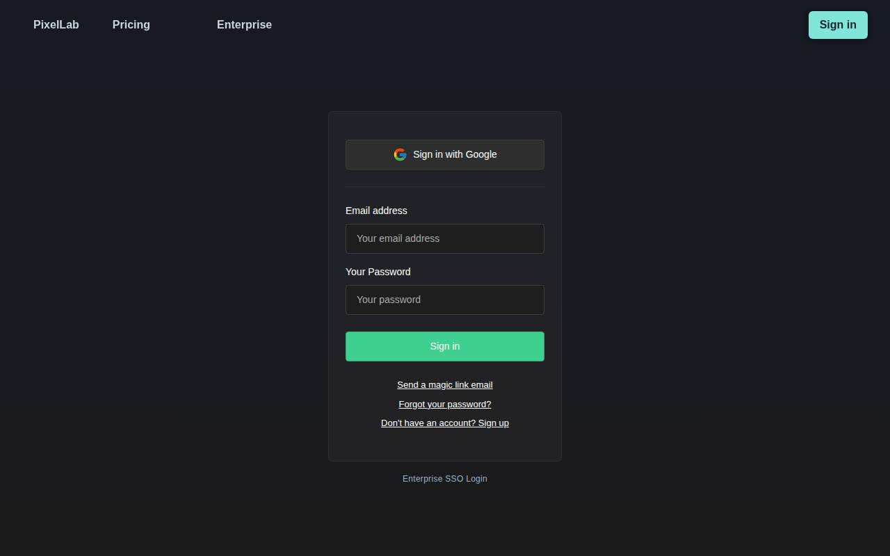

# Characters - PixelLab

[https://www.pixellab.ai/create-character](https://www.pixellab.ai/create-character)

## Summary

The Characters page on PixelLab is an AI-powered design platform dedicated to generating and organizing custom pixel art figures. Geared toward game developers and digital artists, the tool simplifies the asset creation workflow by transforming user prompts into retro-style 2D sprites. Creators can also manage a centralized library of their designs, allowing for easy storage, retrieval, and iteration on character concepts. Overall, the service functions as an accessible utility to speed up production workflows for pixel-based art projects.

## Excerpt

> Create and manage your AI-generated pixel art characters with PixelLab

