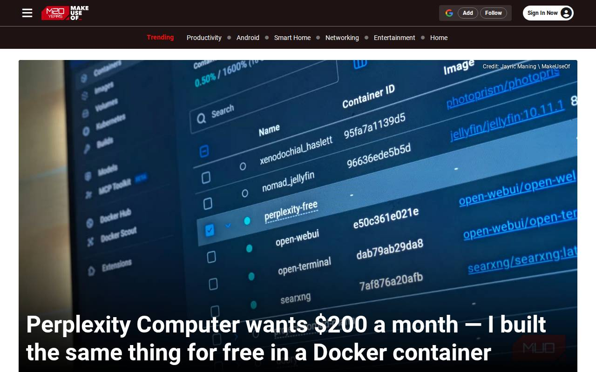

# MakeUseOf - Perplexity Computer wants $200 a month — I built the same thing for free in a Docker...

[https://share.google/9qzDKyyqddX2SMW15](https://share.google/9qzDKyyqddX2SMW15)

## Summary

This article explains how to build a free, self-hosted alternative to expensive AI research and agent tools by deploying open-source software inside a local Docker container. By combining autonomous web-browsing capabilities with local or API-driven language models, the author replicates deep research, synthesis, and automated task execution without a proprietary cloud service. This containerized approach ensures greater data privacy and avoids recurring monthly subscription fees. Ultimately, the guide shows that users with a bit of technical know-how can achieve powerful, customized AI workflows entirely on their own terms.

