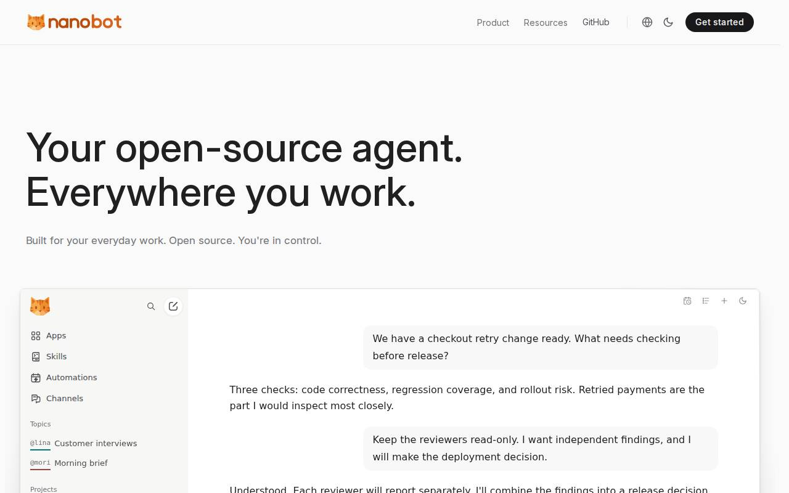

# nanobot - Ultra-Lightweight Open-Source AI Agent

[https://nanobot.wiki/](https://nanobot.wiki/)

## Summary

Nanobot is an ultra-lightweight, open-source personal AI agent designed to run in self-hosted environments. The platform is built to connect with chat applications and streamline everyday task automation. Additionally, it supports long-running workflows capable of managing sustained, ongoing processes. It also offers flexible developer integrations to facilitate custom implementations and extensions.

## Excerpt

> nanobot is an ultra-lightweight, open-source, self-hosted personal AI agent for chat apps, automation, long-running workflows, and developer integrations.

