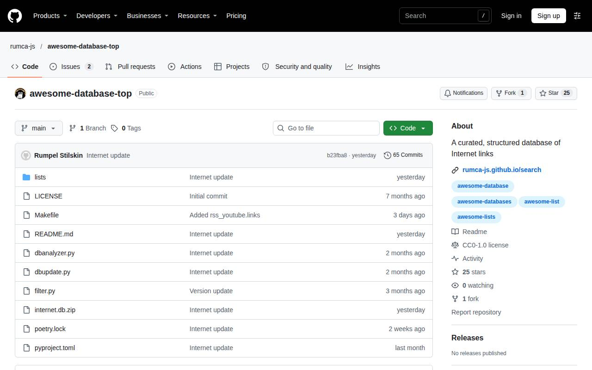

# rumca-js/awesome-database-top

[https://github.com/rumca-js/awesome-database-top](https://github.com/rumca-js/awesome-database-top)

## Summary

The GitHub repository `rumca-js/awesome-database-top` is a project that aggregates and organizes top internet links into a curated, structured database. It primarily collects resources from community-driven "Awesome" lists across GitHub, converting dispersed markdown links into queryable, machine-readable data. This structure allows developers and researchers to easily search, filter, and discover high-quality tools, libraries, and learning materials across various technical domains. By consolidating these recommendations, the project provides a centralized, data-friendly alternative to manually browsing individual resource repositories.

## Excerpt

> A curated, structured database of Internet links

