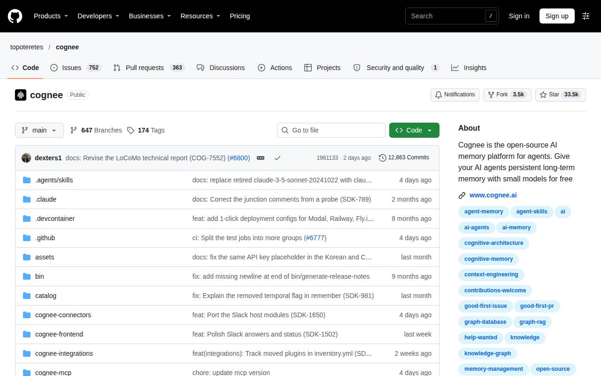

# topoteretes/cognee: Cognee is the open-source AI memory platform for agents. Give your AI agents persistent long-term memory with small models for free

[https://github.com/topoteretes/cognee](https://github.com/topoteretes/cognee)

## Summary

Cognee is the open-source AI memory platform for agents. Give your AI agents persistent long-term memory across sessions with a self-hosted knowledge graph engine

## Excerpt

> Cognee is the open-source AI memory platform for agents. Give your AI agents persistent long-term memory across sessions with a self-hosted knowledge graph engine

